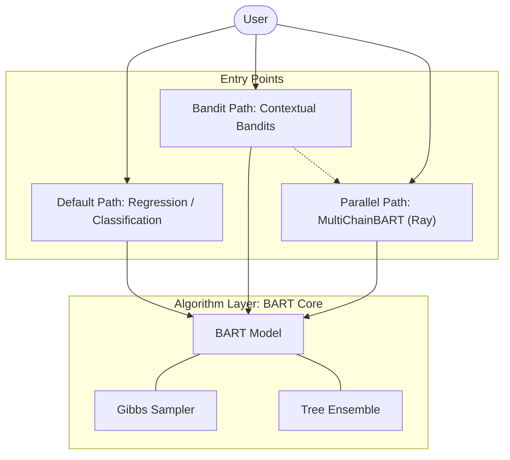
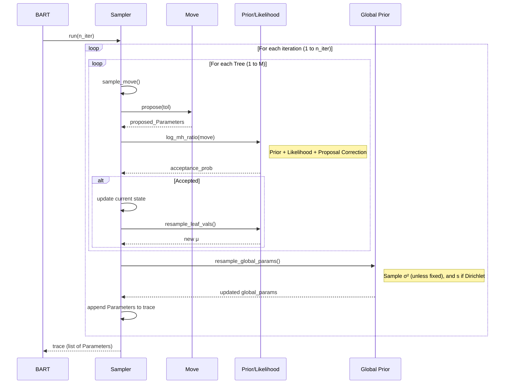
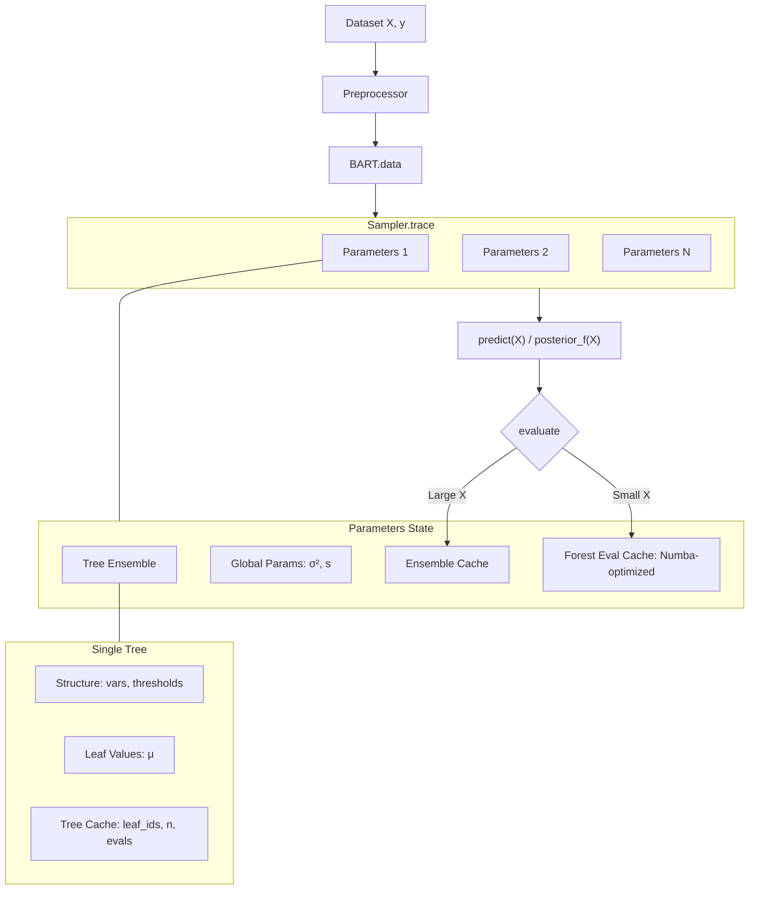
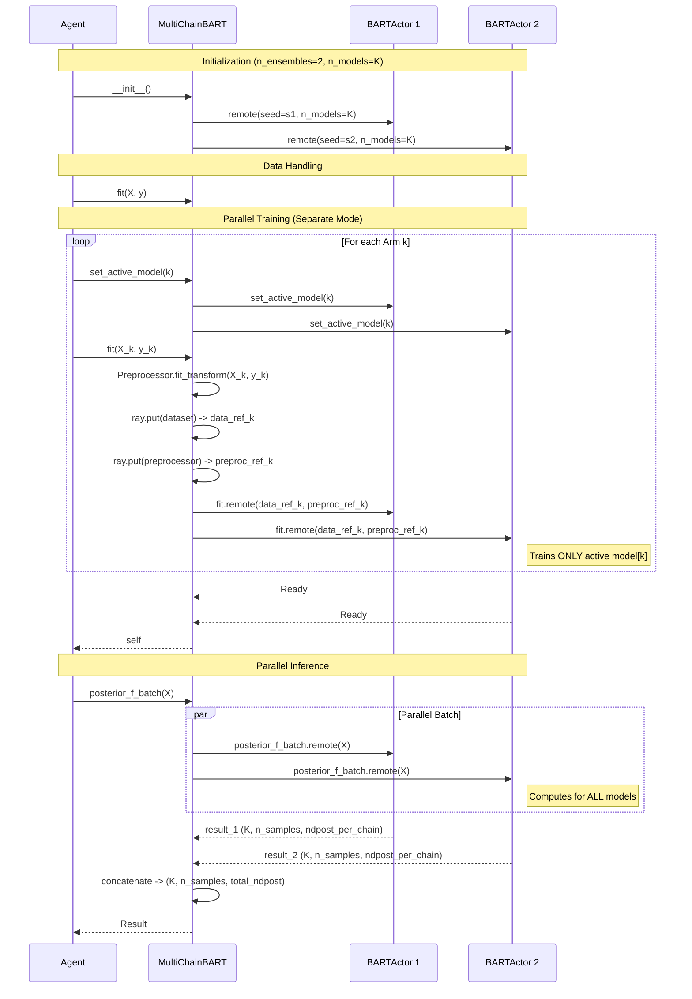
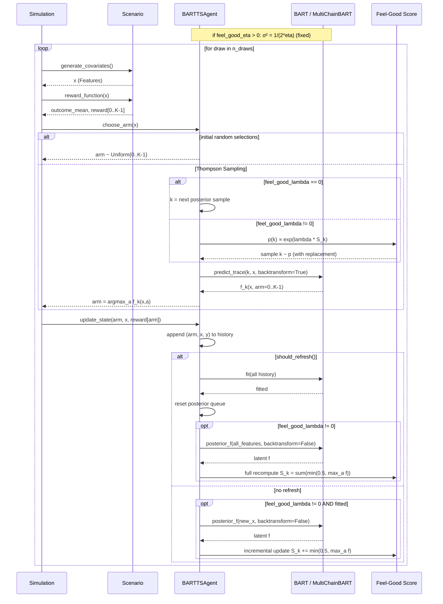

# bart-playground

A fast and modular implementation of Bayesian Additive Regression Trees (BART) for regression and classification tasks, with support for contextual bandits.

## Status

**⚠️ Experimental / Research Use Only**

This package is in early development and is **not production-ready**. The API is unstable and may change without notice. This software is provided for research purposes only.

## Installation


### Using pip (More Flexible)

Use this method to install with flexible version requirements:

```bash
pip install -e .
```

This installs the latest versions that satisfy the minimum requirements in [pyproject.toml](pyproject.toml), which should work but have not been extensively tested. 

###  Using Conda (For Reproducibility)

Use this method to install the exact dependency versions during development:

```bash
conda env create -f environment.yml
conda activate bartts
pip install -e .
```

## Quickstart

### Regression

```python
from bart_playground import DefaultBART, DataGenerator

# Generate synthetic data
X, y = DataGenerator(n_samples=200, n_features=5, noise=0.1, random_seed=1).generate("piecewise_linear")

# Fit model
model = DefaultBART(ndpost=200, nskip=50)
model.fit(X, y, quietly=True)

# Predictions
y_pred = model.predict(X)  # Posterior mean
y_post = model.posterior_predict(X)  # Full posterior samples (n_samples, n_posterior)
```

### Annealed Sequential Monte Carlo (SMC)

`SMCBART` fits Gaussian regression BART with a population of complete tree
ensembles. It targets `prior(theta) * likelihood(y | theta)**beta`, increasing
`beta` from zero to one. Each stage updates log weights, resamples systematically
when ESS is low, and rejuvenates particles with tempered backfitting MCMC.
This follows the resample-move SMC sampler construction of
[Del Moral, Doucet and Jasra (2006)](https://doi.org/10.1111/j.1467-9868.2006.00553.x).

```python
from bart_playground import SMCBART

model = SMCBART(
    n_particles=64,
    n_trees=50,
    n_mcmc_steps=2,          # complete sweeps per particle per stage
    ess_target=0.8,         # conditional ESS / N for choosing the next beta
    resample_threshold=0.5, # ordinary ESS / N for resampling
    random_state=42,
)
model.fit(X, y, quietly=True)
y_mean = model.predict(X)            # weighted particle mean
f_draws = model.posterior_f(X)       # latent f, equally weighted resampled draws
y_draws = model.posterior_predict(X) # draws with observation noise

print(model.beta_history_)           # includes 0 and ends at 1
print(model.stage_diagnostics_)      # beta, ESS before resampling, ancestry, evidence increments
print(model.weights_)               # normalized final population weights
print(model.log_evidence_)           # log evidence on the transformed response scale
```

`n_particles` controls the SMC population; `ndpost` controls the number of final
equally weighted posterior draws and defaults to `n_particles`. `particles_`
and `weights_` retain the weighted population. Resampled draws may share ancestors;
increasing `ndpost` alone does not increase the information in that population.
`predict` uses the weighted population directly, so it can differ slightly from
the average of `posterior_f` after final resampling.

The default schedule uses bisection to choose each beta by **conditional ESS**,
which remains meaningful when the current particle weights are unequal. Pass
`betas=[0.0, 0.01, 0.05, 0.2, 0.5, 1.0]` for a fixed schedule. If an adaptive
run exceeds `max_stages`, fitting raises an error instead of returning an
intermediate tempered distribution.

Initialization draws full trees and leaves from the prior, conditioned on all
leaves containing training observations. It rejects an entire invalid tree
rather than retrying its split rules or imposing a depth cutoff. The variance
is drawn from its data-calibrated inverse gamma prior, or held at
`fixed_eps_sigma2` on the preprocessed response scale. The evidence is relative
to this calibrated prior and transformed response, not the original response
units. Mutation uses single-attempt tree proposals and refreshes every tree's
leaves even if its structure proposal fails.

Annealing is serial within each population. The implementation supports Gaussian regression with uniform
split-variable probabilities. It does not implement classification, sparse
Dirichlet split priors, or seeded forests. `update_fit` runs a fresh annealed
SMC fit on all accumulated observations using the existing response scaling;
it is not an online particle filter.

For a **full-population posterior sample set**, retain all particles at beta=1:

```python
model = SMCBART(n_particles=100, n_trees=100, random_state=2024).fit(X, y, quietly=True)
for sweep, particles in model.iter_posterior_populations(
    n_sweeps=100, burn_sweeps=50, random_state=20261016
):
    # Summarize all 100 states immediately: 100 sweeps yield 10,000 samples.
    # Objects are borrowed and may change when the iterator advances.
    predictions = [model.preprocessor.backtransform_y(p.evaluate(X_test)) for p in particles]
```

For optional **posterior particle parallelism**, use the numeric collector:

```python
# Put process-launching code inside this guard in standalone scripts.
if __name__ == "__main__":
    model = SMCBART(n_particles=50, n_trees=100, random_state=2024, n_jobs=8)
    model.fit(X, y, quietly=True)  # Annealing settings and execution are unchanged.
    draws = model.sample_posterior(
        X_test, n_sweeps=1000, burn_sweeps=0, random_state=20261016
    )
    # (50000, len(X_test)), original response units, sweep-major / particle-minor.
    predictions = draws["preds"]
    # Observation variances on the transformed training-response scale.
    variances = draws["sigmas"]
    variable_counts = draws["vars_histogram"]
```

`n_jobs=1` is the default and starts no child processes. Like PT, `None` uses
one process per particle, `-1` uses available physical cores, `-2` all but one,
and positive values request that many processes, capped only at the particle
count. This setting affects `sample_posterior` only. Each task runs an entire
particle path, including warm-up, with one BLAS thread; particles' sequential
tree backfitting and within-particle sweep order are preserved. Prediction and
variance/variable-count extraction happen in the worker. Shared read-only file
mappings avoid copying training data for every task. `temp_dir` can select
existing local server scratch; temporary files are removed after workers exit.

The collector uses fixed, independent RNG streams for terminal resampling and
each offspring ID (including offspring with the same ancestor). For the same
fitted population, seed and numerical environment, serial and parallel results
are identical across worker counts. Its streams differ from the legacy
`iter_posterior_populations` iterator, which remains serial and retains its old
shared RNG behavior. The mutation kernel and target posterior are unchanged.
The experiment runner now uses the collector even in serial mode, so new runs
do not reproduce the earlier iterator-based runs sample for sample. Saved old
experiments are unchanged. Four independent repetitions still require four
separate SMC fits/seeds; particle workers do not count as extra repetitions.

The collector returns float64 predictions/variances and int32 variable counts.
Pass a dictionary of writable arrays or `.npy` memmaps with the documented
shapes as `outputs` to store long experiments on disk. Only endpoint forests
are kept in `model.posterior_population_`. Counters are aggregated in
`model.posterior_move_counts_`, with actual process count in
`model.posterior_workers_`. `progress_callback(done, total)` counts completed
**whole particle paths**, not completed population rounds; parallel paths can
finish out of order. Results are assembled by particle ID regardless of finish
order. Warm-up and retained sweeps use exactly the same beta=1 kernel.

This performs terminal equal-weight resampling and updates every particle with
the existing SMC mutation kernel. It does not select a particle to initialize
a long Default chain. Samples share genealogy and serial dependence along each
particle path; pooled particle/sweep indices are not a single Markov chain.
Do not interpret rank-normalized split/folded R-hat, rolling/segment R-hat or
flattened-chain MCMC ESS on that layout as calibrated convergence diagnostics.
The posterior-set comparisons are permutation-invariant
`R_B/W`, RMSE, posterior-predictive CRPS and scalar/interval distributions.

Run the current Abalone run-0 population experiment with:

```bash
python diagnosis/run_smc_population.py
```

Four processes each run one independent 100-particle population, with 100 trees,
two MCMC sweeps per annealing stage, 50 beta=1 population warm-up sweeps and 100
retained population sweeps. Each repeat yields 10,000 equally weighted states.
Results are saved under `diagnosis/store_smc_population/fixed100_Abalone/run000/`,
including particle/sweep identities. The full-population analysis uses every
SMC sample and the paper's post-burn baseline records; an additional matched
comparison selects 70 evenly spaced sweeps (all particles, 7,000 states) against
7,000 baseline states. No arbitrary flattened prefix is treated as burn-in.
CRPS adds observation noise on the response scale and uses canonical ordering
to make the finite, fixed-seed Monte Carlo score invariant to sample permutation.
These are posterior-set/replicate comparisons, not equal-wall-time comparisons
or calibrated MCMC convergence tests. Use `--analyze-only` to repeat analysis.

For four simultaneous populations on a server allocated 32 CPUs, run the
50-particle, 1,000-round experiment using eight posterior workers per population:

```bash
python diagnosis/run_smc_population.py --dataset abalone --n-particles 50 --warmup-sweeps 0 --retained-sweeps 1000 --jobs 4 --posterior-n-jobs 8 --skip-analysis --output diagnosis/store_smc_population/fixed100_Abalone/run000_p50_w0_s1000_parallel8
```

Use `--dataset seoul_bike` and a fresh output path for SeoulBike. Omitting
`--posterior-n-jobs` keeps posterior collection serial within each of the four
populations. `--jobs` is independent and controls simultaneous repetitions
(four repetitions always run in total). Request roughly
`jobs * posterior_workers_per_chain` CPUs for the active computation; four
coordinator processes also exist, mainly waiting/writing during the posterior
phase. Avoid `--posterior-n-jobs -1` for multiple simultaneous repetitions
unless each chain really has its own allocation: the available-core count is
resolved per chain. Annealing still uses one CPU per active population.
Settings/timings record both concurrency levels and the RNG scheme; numeric
outputs, particle/sweep identities and existing window analyses keep the same
layout. CPU timings sum parent CPU time and worker task CPU time, excluding
spawn/import overhead; posterior wall time includes process startup and output.
Whole-path scheduling has no shared end-of-warm-up timestamp; the historical
`posterior_warmup_and_first_sweep_seconds` timing field is now null.

The 50-particle comparison uses 60 beta=1 warm-up sweeps and 140 retained
sweeps (7,000 states per repeat), with the same four-process execution:

```bash
python diagnosis/run_smc_population.py --n-particles 50 --warmup-sweeps 60 --retained-sweeps 140 --jobs 4 --output diagnosis/store_smc_population/fixed100_Abalone/run000_p50_w60_s140 --reference-population diagnosis/store_smc_population/fixed100_Abalone/run000
```

The optional reference adds the earlier population experiment to the comparison.
Each population's matched analysis selects whole, evenly spaced sweeps using
its own particle count. This retains all states when there are already 7,000.
Sampling refuses to overwrite an existing output directory; use `--analyze-only`
with the same output and reference paths to regenerate diagnostics.

The same 50-particle configuration on SeoulBike run 0 is:

```bash
python diagnosis/run_smc_population.py --dataset seoul_bike --n-particles 50 --warmup-sweeps 60 --retained-sweeps 140 --jobs 4 --output diagnosis/store_smc_population/fixed100_SeoulBike/run000_p50_w60_s140
```

The runner checks training/test row indices and the encoded fixed-test predictors
and targets against the stored dataset before sampling. Analysis compares all
available baseline methods, including the contiguous long-chain endpoint record
(`default_long_tail`) when present. Retained-block diagnostics describe changes
over each method's own record; neither a long run nor a low between-repeat ratio
is assumed to establish stationarity, and stationarity is not an acceptance rule
for these finite-budget comparisons.

For the longer population-window study, keep every beta=1 sweep at collection
time (`--warmup-sweeps 0 --retained-sweeps 1000`). With 50 particles this stores
50,000 states per repeat. Run Abalone first and SeoulBike second, with four
independent repeats in parallel inside each dataset:

```bash
python diagnosis/run_smc_population.py --dataset abalone --n-particles 50 --warmup-sweeps 0 --retained-sweeps 1000 --jobs 4 --skip-analysis --output diagnosis/store_smc_population/fixed100_Abalone/run000_p50_w0_s1000
python diagnosis/analyze_smc_windows.py --output diagnosis/store_smc_population/fixed100_Abalone/run000_p50_w0_s1000
python diagnosis/run_smc_population.py --dataset seoul_bike --n-particles 50 --warmup-sweeps 0 --retained-sweeps 1000 --jobs 4 --skip-analysis --output diagnosis/store_smc_population/fixed100_SeoulBike/run000_p50_w0_s1000
python diagnosis/analyze_smc_windows.py --output diagnosis/store_smc_population/fixed100_SeoulBike/run000_p50_w0_s1000
```

Window analysis uses 140 consecutive population sweeps (all 50 particles,
7,000 states per repeat), advancing the window start by 20 sweeps. It reports all
44 windows, a disjoint subset, predefined anchor windows, and the existing
post-burn baseline records. Sweep labels in the tables are one-based inclusive.
The 61--200 window reproduces the earlier 60-warm-up/140-collection experiment
with identical seeds. Overlapping windows are dependent sensitivity checks;
they do not increase the number of independent experimental repeats.

The earlier **historical initialization-only** experiment is retained for
reproducibility. Its `initialize_posterior_chain(random_state=...)`
selects one particle by its final weight, reconstructs its training caches, and
returns a `DefaultBART` model initialized at that state. Its sampler uses the
ordinary Default kernel with `tol=1`. Subsequent consecutive updates are real
production states; the selected initial state is not counted as a new draw.
Independent diagnostic chains must each start with an independent SMC fit.

The Abalone run-0 experiment is reproducible with:

```bash
python diagnosis/run_smc.py
```

This uses four processes with one computational thread each. Each process runs
100 particles and 100 trees, adaptive conditional ESS 0.8, resampling threshold
0.5, and two mutation sweeps per stage, then records 10,000 consecutive Default
MCMC states. The method is labelled **SMC-initialized Default MCMC**, rather
than treating duplicated final particles as a time series. Diagnostics follow
the paper's 3,000-draw exclusion, 1,000-draw cross-chain windows, and four
consecutive within-chain segments. Initialization and production costs are
recorded separately, and initialization is included in total cost. Outputs
are under `diagnosis/store_smc/fixed100_Abalone/run000/`; existing results are
read for comparison. To rerun only the analysis, pass `--analyze-only`.

### Binary Classification

```python
from bart_playground import ProbitBART

# X: (n_samples, n_features), y: binary {0, 1}
model = ProbitBART(ndpost=200, nskip=50)
model.fit(X, y, quietly=True)

# Predictions
proba = model.predict_proba(X)  # (n_samples, 2) - probabilities for classes 0 and 1
y_hat = model.predict(X)  # Binary predictions
```

### Multiclass Classification

```python
from bart_playground import LogisticBART

# X: (n_samples, n_features), y: categorical {0, ..., K-1}
model = LogisticBART(ndpost=200, nskip=50)
model.fit(X, y, quietly=True)

# Predictions
proba = model.predict_proba(X)  # (n_samples, n_categories) - class probabilities
y_hat = model.predict(X)  # Class predictions
```

## Bandit Usage

The package includes BART-based agents for contextual bandit problems.

### Basic Usage

```python
from bart_playground.bandit.agents.bart_ts_agents import DefaultBARTTSAgent

# Initialize agent
agent = DefaultBARTTSAgent(
    n_arms=3, 
    n_features=4, 
    encoding='multi', 
    random_state=42,
    bart_kwargs={
        "ndpost": 100,
        "nskip": 50
    }
)

# Bandit loop
for t in range(100):
    x = ...  # Feature vector of length n_features
    arm = agent.choose_arm(x)  # Select arm
    y = ...  # Observe reward for the chosen arm
    agent.update_state(arm, x, y)  # Update agent state
```

### Simulation Framework

For running bandit simulations, use the `simulate` function:

```python
from bart_playground.bandit.experiment_utils.simulation import Scenario, simulate

class MyScenario(Scenario):
    def init_params(self):
        # Initialize scenario parameters
        pass
    
    def reward_function(self, x):
        # Compute expected rewards and noisy observations
        # Return {"outcome_mean": array, "reward": array}
        ...

# Run simulation
scenario = MyScenario(P=4, K=3, sigma2=1.0)
cum_regrets, time_agents = simulate(scenario, [agent], n_draws=100)
```

## System Architecture

Choose the section relevant to your use case:
- **Default (Regression/Classification)**: See [1. BART Core (Algorithm)](#1-bart-core-algorithm)
- **Contextual Bandits**: Expand [2. Bandit Loop (Optional)](#2-bandit-loop-optional)
- **Parallel Chains (Speedup)**: Expand [3. Parallelism Layer (Optional)](#3-parallelism-layer-optional)



### 1. BART Core (Algorithm)

`bart-playground` uses a sampler-driven architecture where the core logic resides in the Gibbs sampler (Backfitting MCMC). The sampler iteratively proposes modifications to the tree ensemble and samples parameters from their posterior distributions.

#### 1.1 Sampler Iteration Skeleton

This diagram illustrates the `Sampler.run()` process, including the tree-by-tree Metropolis-Hastings (MH) steps and global parameter resampling.



#### 1.2 State & Caching Overview

The model maintains a `trace` of `Parameters` objects. To ensure high performance, evaluation results are cached at both the tree and ensemble levels.



### 2. MultiChainBART (Parallelism)
<details>
<summary><b>Parallelism Layer</b></summary>

The `MultiChainBART` class coordinates parallel execution using Ray actors. It supports two modes:
1. **Standard Mode**: Single model per chain.
2. **Separate Models Mode** (`encoding='separate'`): Each chain maintains `K` independent models internally (one per arm).

The second mode is more complicated and suggested for most multi-arm bandit problems, so we present it here (with 2 chains) and omit the first mode for simplicity.



#### Key Concepts

- **Active Model**: For stateful operations like `fit()`, `MultiChainBART` sets an "active" model index on all actors. Subsequent calls operate only on that specific model (e.g., training arm $k$).
- **Batch APIs**: For inference, methods like `posterior_f_batch` trigger computation across **all** internal models simultaneously within each actor, reducing Ray overhead.
</details>

### 3. Bandit Usage

<details>
<summary><b>Bandit Usage</b></summary>

The bandit loop describes how the Agent interacts with the Environment (Scenario) and when model updates are triggered. It also highlights the "Feel-Good" mechanism, which optionally weights posterior samples towards those with higher historical utility.

To improve FGTS sampling, Sequential Monte Carlo and Reversible Jump MCMC could be used, but are left for future work.


</details>


## Caveats

- **No stability guarantees**: APIs may change without notice or documentation updates.
- **Research use only**: This package is not intended for production deployments.
- **Performance**: While optimized for speed, performance characteristics may vary with data size and model configuration.

