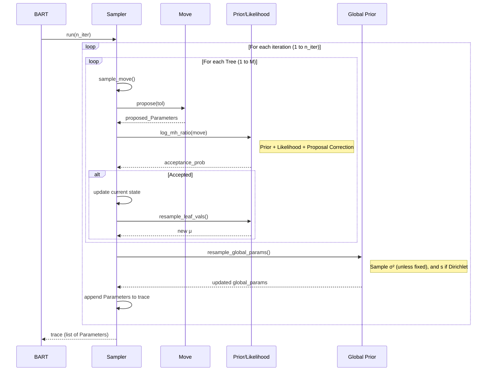
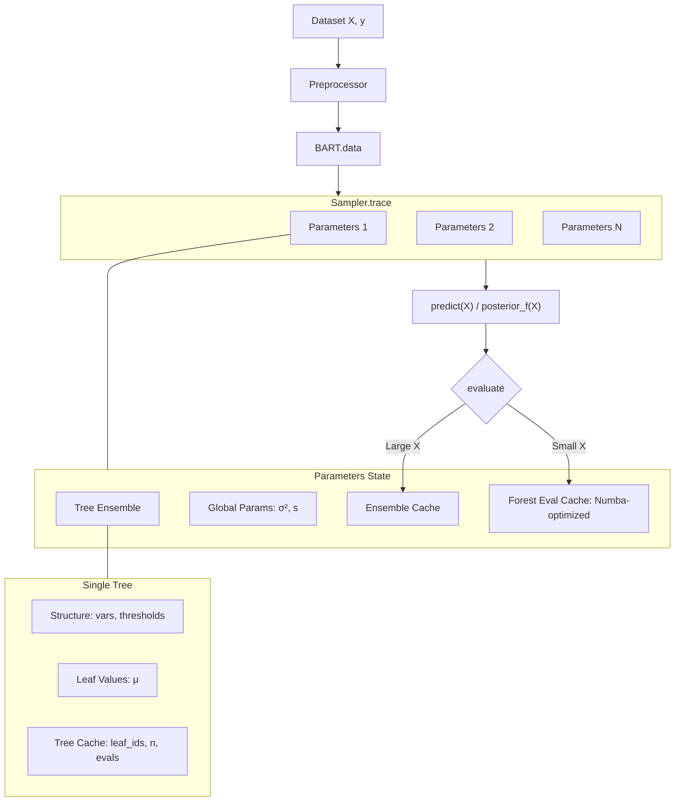
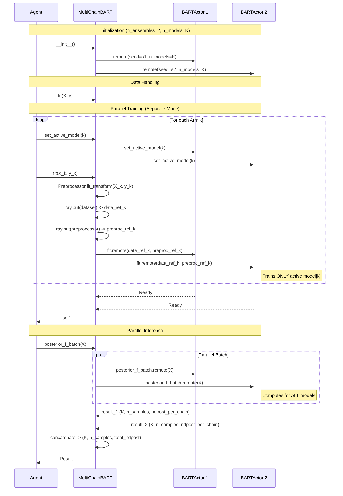
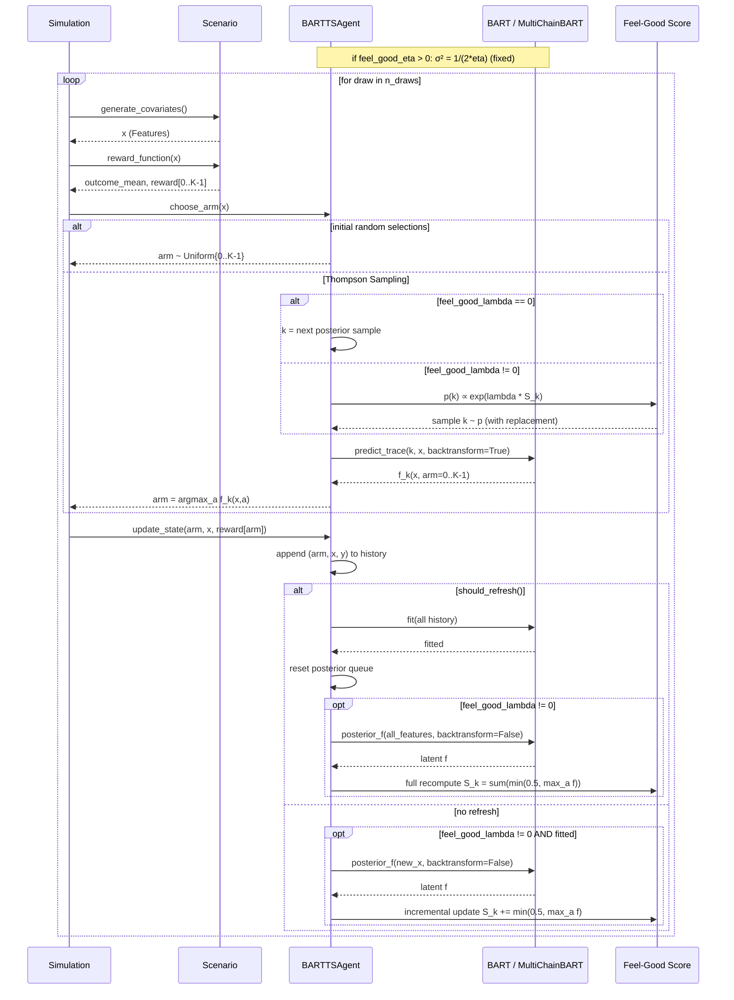

# bart-playground

A fast and modular implementation of Bayesian Additive Regression Trees (BART) for regression and classification tasks, with support for contextual bandits.

## Status

**⚠️ Experimental / Research Use Only**

This package is in early development and is **not production-ready**. The API is unstable and may change without notice. This software is provided for research purposes only.

## Installation


### Using pip (More Flexible)

Use this method to install with flexible version requirements:

```bash
pip install -e .
```

This installs the latest versions that satisfy the minimum requirements in [pyproject.toml](pyproject.toml), which should work but have not been extensively tested. 

###  Using Conda (For Reproducibility)

Use this method to install the exact dependency versions during development:

```bash
conda env create -f environment.yml
conda activate bartts
pip install -e .
```

## Quickstart

### Regression

```python
from bart_playground import DefaultBART, DataGenerator

# Generate synthetic data
X, y = DataGenerator(n_samples=200, n_features=5, noise=0.1, random_seed=1).generate("piecewise_linear")

# Fit model
model = DefaultBART(ndpost=200, nskip=50)
model.fit(X, y, quietly=True)

# Predictions
y_pred = model.predict(X)  # Posterior mean
y_post = model.posterior_predict(X)  # Full posterior samples (n_samples, n_posterior)
```

### Binary Classification

```python
from bart_playground import ProbitBART

# X: (n_samples, n_features), y: binary {0, 1}
model = ProbitBART(ndpost=200, nskip=50)
model.fit(X, y, quietly=True)

# Predictions
proba = model.predict_proba(X)  # (n_samples, 2) - probabilities for classes 0 and 1
y_hat = model.predict(X)  # Binary predictions
```

### Multiclass Classification

```python
from bart_playground import LogisticBART

# X: (n_samples, n_features), y: categorical {0, ..., K-1}
model = LogisticBART(ndpost=200, nskip=50)
model.fit(X, y, quietly=True)

# Predictions
proba = model.predict_proba(X)  # (n_samples, n_categories) - class probabilities
y_hat = model.predict(X)  # Class predictions
```

## Bandit Usage

The package includes BART-based agents for contextual bandit problems.

### Basic Usage

```python
from bart_playground.bandit.agents.bart_ts_agents import DefaultBARTTSAgent

# Initialize agent
agent = DefaultBARTTSAgent(
    n_arms=3, 
    n_features=4, 
    encoding='multi', 
    random_state=42,
    bart_kwargs={
        "ndpost": 100,
        "nskip": 50
    }
)

# Bandit loop
for t in range(100):
    x = ...  # Feature vector of length n_features
    arm = agent.choose_arm(x)  # Select arm
    y = ...  # Observe reward for the chosen arm
    agent.update_state(arm, x, y)  # Update agent state
```

### Simulation Framework

For running bandit simulations, use the `simulate` function:

```python
from bart_playground.bandit.experiment_utils.simulation import Scenario, simulate

class MyScenario(Scenario):
    def init_params(self):
        # Initialize scenario parameters
        pass
    
    def reward_function(self, x):
        # Compute expected rewards and noisy observations
        # Return {"outcome_mean": array, "reward": array}
        ...

# Run simulation
scenario = MyScenario(P=4, K=3, sigma2=1.0)
cum_regrets, time_agents = simulate(scenario, [agent], n_draws=100)
```

## System Architecture

Choose the section relevant to your use case:
- **Default (Regression/Classification)**: See [1. BART Core (Algorithm)](#1-bart-core-algorithm)
- **Contextual Bandits**: Expand [2. Bandit Loop (Optional)](#2-bandit-loop-optional)
- **Parallel Chains (Speedup)**: Expand [3. Parallelism Layer (Optional)](#3-parallelism-layer-optional)


### 1. BART Core (Algorithm)

`bart-playground` uses a sampler-driven architecture where the core logic resides in the Gibbs sampler (Backfitting MCMC). The sampler iteratively proposes modifications to the tree ensemble and samples parameters from their posterior distributions.

#### 1.1 Sampler Iteration Skeleton

This diagram illustrates the `Sampler.run()` process, including the tree-by-tree Metropolis-Hastings (MH) steps and global parameter resampling.



#### 1.2 State & Caching Overview

The model maintains a `trace` of `Parameters` objects. To ensure high performance, evaluation results are cached at both the tree and ensemble levels.



### 2. MultiChainBART (Parallelism)
<details>
<summary><b>Parallelism Layer</b></summary>

The `MultiChainBART` class coordinates parallel execution using Ray actors. It supports two modes:
1. **Standard Mode**: Single model per chain.
2. **Separate Models Mode** (`encoding='separate'`): Each chain maintains `K` independent models internally (one per arm).

The second mode is more complicated and suggested for most multi-arm bandit problems, so we present it here (with 2 chains) and omit the first mode for simplicity.



#### Key Concepts

- **Active Model**: For stateful operations like `fit()`, `MultiChainBART` sets an "active" model index on all actors. Subsequent calls operate only on that specific model (e.g., training arm $k$).
- **Batch APIs**: For inference, methods like `posterior_f_batch` trigger computation across **all** internal models simultaneously within each actor, reducing Ray overhead.
</details>

### 3. Bandit Usage

<details>
<summary><b>Bandit Usage</b></summary>

The bandit loop describes how the Agent interacts with the Environment (Scenario) and when model updates are triggered. It also highlights the "Feel-Good" mechanism, which optionally weights posterior samples towards those with higher historical utility.

To improve FGTS sampling, Sequential Monte Carlo and Reversible Jump MCMC could be used, but are left for future work.


</details>


## Adaptive SMC with PT weights (smc2)

`AdaptiveSMCBART` implements the requested configuration on a branch based
directly on `mtmh_pt`: 1,000 complete-ensemble particles, ordinary importance
ESS/N = 0.5 selected by bisection, and 100 **original DefaultSampler** sweeps
at every temperature. Unlike the earlier `smc` branch, it does not add a full
leaf Gibbs pass to every Default update or replace the Default variance kernel.
It uses the baseline experiment's `tol=1` and standard four move probabilities.

The importance target is the same collapsed, likelihood-tempered target used
by the actual PT swap implementation: integrate leaf values out of
`prior(leaves) * likelihood**beta`. The increment is the difference between
the two log targets, **not** a power of the beta=1 marginal likelihood and
not the two-particle PT swap acceptance probability. Cached SVD projections
evaluate the PT formula without retaining 1,000 dense leaf-basis matrices;
tests compare it against `_collapsed_loglik_for_sampler_state` and Gaussian
integration. Beta zero is the calibrated prior with log likelihood weight zero.

Every temperature uses systematic resampling, including the final temperature,
so importance weighting always starts equally weighted. After resampling,
one joint conditional leaf refresh at the new temperature lifts the collapsed
particle to the correct joint target, using PT's existing refresh function.
Exactly 100 unchanged Default sweeps follow this lift. The lift is recorded
separately and does not replace one of those 100 steps. Importance ESS is not
MCMC effective sample size. Collapsed-weight ESS need not be globally monotone
in temperature; the bisection maintains a feasible/infeasible crossing bracket,
and a feasible endpoint goes straight to beta=1.

```python
from bart_playground import AdaptiveSMCBART

if __name__ == "__main__":
    model = AdaptiveSMCBART(n_particles=1000, n_mcmc_steps=100,
                           ess_ratio=0.5, n_trees=100, n_jobs=8,
                           random_state=2024)
    model.fit(X_train, y_train, X_test=X_test, retained_sweeps=7,
              output_dir="smc2_draws", checkpoint_path="smc2_checkpoint.pkl")
    endpoints = model.trace                  # 1,000 equal-weight terminal states
    predictions = model.posterior_draws_["preds"]  # 7,000 x n_test
```

`retained_sweeps=7` saves rounds 94--100 of the final temperature's existing
100 rejuvenation steps, all particles per round, without any extra posterior
updates. Numeric predictions are on the original response scale; `sigmas`
stores variance on the internal response scale; feature counts are int32.
Rows are sweep-major, particle-minor. The final 1,000 rows are also exported
separately by the experiment runner. Shared ancestry and path dependence remain.

`n_jobs=1` is serial by default; positive worker counts are capped by particle
count, `None` uses one per particle, and negative counts follow PT's available
physical-core convention. Particles are parallelized during **all** stages,
including prior/SVD preparation and rejuvenation. Each task owns a whole
100-step block, shares read-only training inputs through file mappings, and
returns a cache-free endpoint. Streams use fixed stage/offspring IDs, giving
worker-count-invariant results in the same environment. Each worker uses one
BLAS thread. Global beta selection and systematic resampling remain sequential.

For the two run-0 datasets with four independent populations each:

```bash
python diagnosis/run_smc2.py --datasets abalone seoul_bike --output diagnosis/store_smc2/supervisor_run0 --chain-jobs 4 --particle-jobs 2
```

This requests eight active particle workers in total; server allocations can
increase `--particle-jobs`. Datasets run sequentially. Defaults are N=1000,
K=100, 100 trees and seven retained final-temperature rounds. Every completed
temperature has an atomic checkpoint; use the same command with `--resume`
after interruption. Only load trusted, locally generated pickle checkpoints.
Data and statistical settings are fingerprinted, while worker counts can
change on resume. Progress and ancestry are saved for every temperature.

The analysis reports R_B/W and the outline's Relative RMSE / Relative CRPS for
both terminal particles and the 7,000-state set, alongside the existing run-0
baselines and the old SMC's early/final windows when available. Terminal-count
comparisons select 1,000 evenly spaced states from each baseline's 7,000-state
post-burn record. No flattened-population rank R-hat or MCMC ESS is reported.
These comparisons match saved counts, not computation or effective sample size.
The code retains the original Default kernel's numerical variance floor;
it makes no claim that such inherited finite-precision safeguards are an
exact continuous-target algorithm in the floor's extreme tail.

## Caveats

- **No stability guarantees**: APIs may change without notice or documentation updates.
- **Research use only**: This package is not intended for production deployments.
- **Performance**: While optimized for speed, performance characteristics may vary with data size and model configuration.

